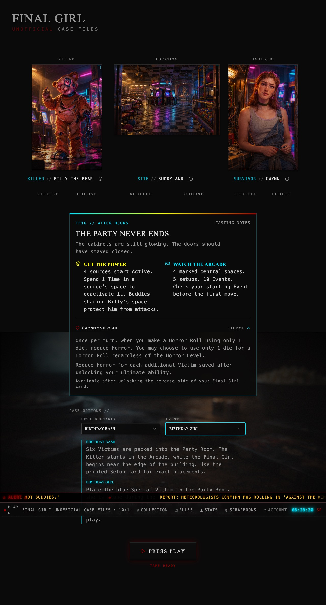

# Bad Times at Buddyland (FF16)

Adds Billy the Bear, Buddyland, Rena and Gwynn to the existing collection, casting, story, outcome, scrapbook and statistics flows. Enable **Bad Times at Buddyland** in My Collection, then cast any combination of owned Killers, Locations and Final Girls.

## Release

Collection and casting use the existing tables and settings. The new [Buddyland Play module](BUDDYLAND_PLAY.md) also requires deploying `generate-death-scene` and `narrate-story` with the frontend, because they validate the shared module observations and death signatures. **No SQL migration, new secret or data backfill is required.** Merge the PR into `main`, let Lovable sync it, and publish with those function updates.

Existing collection settings and saved games remain compatible. Billy's existing outcome fields keep their draft keys. Optional Power Surge and Boris fields also survive reload; an unreported Buddy count stays unknown rather than becoming zero. All writes still go through the account-scoped active draft and durable history queue.

## Verified content

| Content | Included |
| --- | --- |
| Cast | Billy the Bear; Buddyland; Rena; Gwynn |
| Starting Health | Billy 8; Rena 6; Gwynn 5 |
| Starting Horror | Billy 4 |
| Setups | Hide and Seek; Playin’ Hooky; Buddy Day; Pizza Party; Birthday Bash |
| Events | Hidden Prizes; Party Time; Broken Machine; Tragic Collapse; Playtime Shenanigans; Buddy Up; Sing-A-Long; Nick the Janitor; Birthday Girl; Pizza Delivery |
| Final Girls | Paraphrased supplied biographies, reverse-side abilities and additional-save rewards |
| Rules | Searchable Special Setup / Special Rules chapters for Billy and Buddyland, independently |
| Narrative | Entity-specific visual descriptions, opening and ending module context, selected Setup/Event descriptions |
| Artwork | Three character portraits, one Location image, one VHS cover |

Rena's previous 5-Health entry and Gwynn's previous 6-Health entry were reversed; the supplied cards confirm 6 and 5 respectively. Birthday Girl panics when alone during the Panic phase. Billy's battery-heart healing resolves only when its icon is applied and a source is Active. A Buddy in Billy's space prevents attacks on him. A Buddy spawned during the Killer phase waits until the next Killer phase to activate. Power Surge requires defeating both Billy and Boris.

Billy's power and Buddy mechanics follow **Billy**, including mixed games at another Location. Other Killers visiting Buddyland do not acquire them. The same separation applies to casting notes, generation context and outcome fields.

## Sources and artwork provenance

- [Publisher product page](https://vanrydergames.com/products/bad-times-at-buddyland).
- [Official Billy rules sheet](https://cdn.shopify.com/s/files/1/0593/6984/8897/files/FG_FF16_Buddy_Rules.pdf?v=1744743622), including the printed Power Surge Finale and Final Girl Health references.
- [Official Buddyland rules sheet](https://cdn.shopify.com/s/files/1/0593/6984/8897/files/FG_FF16_Buddyland_Rules.pdf?v=1744743647).
- Owner-supplied photographs of all five Setup cards, all ten Event cards, the Final Girl reverse sides and the Rena/Gwynn biographies, supplied October 17, 2026. Photos remain outside the repository. Setup summaries support narration; use the physical Setup cards for exact board placements.
- Rules-sheet credits: design by Motti Eisenbach; art by Jacqui Davis. Location board and Item art by Agnieszka Dąbrowiecka.

The five added images are **original AI-generated fan artwork**, made for this app using the supplied/publisher character and setting references. They are not official Van Ryder Games illustrations. They live under `src/assets/*/ai/` and use the existing missing-official-art fallback, so Buddyland remains illustrated with either casting-art preference. Existing official art is preserved. Dropping official images into the corresponding top-level asset folders will take precedence under the standard preference.

The app remains a play aid: it does not simulate the board, resolve die rolls or replace printed cards. Play mode now optionally tracks individual Buddies, sources, powers, Finales, Events, Special Victims and Items; see [the Play module coverage and remaining evidence gaps](BUDDYLAND_PLAY.md). Its existing footer disclaimer remains in place.

## Review and validation

Run `npm run check`, `npm run check:assets`, `npm run build` and `npm run test:browser`. Browser tests use a fictional account and mock every external backend/provider request; no production data or AI credits are used.

New coverage verifies cast ownership and lookup, Health, all Setup/Event options, real art registration under both preferences, source-backed rules, mixed-module narrative context, opening/ending generation payloads, Billy-only outcomes, Power Surge and Boris, and draft recovery before saving. Desktop and mobile browser artifacts include Collection, casting, Rena's dossier, rules and outcome screenshots.

Manual review: enable the film in My Collection; cast Billy / Buddyland / Rena or Gwynn; inspect the info buttons and ability reference; choose a Setup and Event; search the owned rules; record a result, reload and resume, then save without narration. Try Billy at Camp Happy Trails and Hans at Buddyland to check independent modules.

## Review screenshots

Captured from passing browser tests with a fictional account and mocked generation. The screenshots include the complete casting flow at desktop and mobile widths; the CI `browser-results` artifact also contains dossiers, rules and outcomes. External fonts are blocked in these isolated tests.

[Desktop casting](images/buddyland-desktop.jpg) · [Mobile casting](images/buddyland-mobile.jpg)

