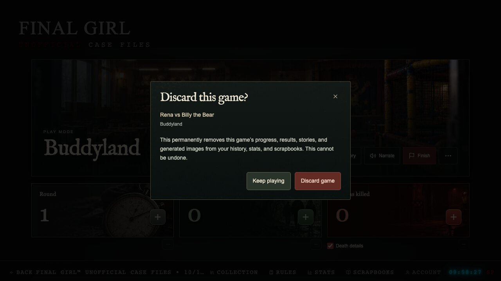
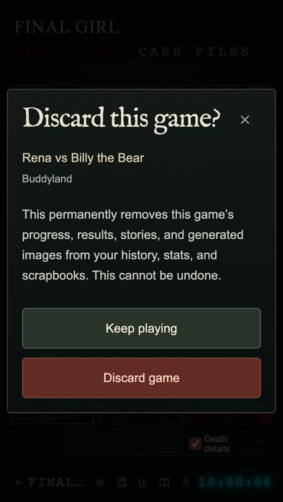

# Discard a game

Open **Session options** (`⋯`) beside Finish in Play mode, or in the opening story. The ending reader keeps only Save and Narrate. The result form exposes the same action under **More options**. Choose **Discard game…** to open a confirmation naming the Final Girl, killer, and location.

**Keep playing** receives focus. Escape, the close control, and the backdrop cancel before submission. **Discard game** requires explicit confirmation; while the request is pending the dialog stays open. A failed server acknowledgement preserves the local game and offers **Retry discard**.

After confirmation, Setup retains the selected cast, scenario, event, and mission. Press Play creates a new session ID with fresh progress.

## Removal and recovery

- The authenticated transaction deletes this game's history/result and play session. The existing foreign key cascades its saved gruesome death scenes. Stats, scrapbooks, home reels, and cloud resume no longer include it.
- The browser removes only this game's active draft, cached result, queued writes, revisions, handoff backup, and associated narration clips. Shared audio retains associations with other games. Other games, accounts, collection selections, and settings remain intact.
- The function removes managed images in the owner's storage folder with this game's exact scene/poster prefix. Shared artwork is not deleted. If storage cleanup fails, a durable pending flag prompts retries on reload, focus, reconnect, and a 30-second pending-cleanup refresh.
- A content-free owner/game marker blocks stale RPC saves and direct history/session writes, including older clients. Another device learns markers on load, focus, or reconnect. Late image uploads check the marker and remove their output; cleanup revisions prevent a late upload from being hidden by an older cleanup acknowledgement.
- Signed-in deletion needs a successful server response. Guests discard local data directly. Repeating an already-completed discard is safe, including after a lost response.

## Deployment order

1. Apply the new migration after the existing migrations: **`supabase/migrations/20261019160000_discard_game_session.sql`**. Projects managed through Drizzle use the identical **`drizzle/migrations/0004_discard_game_session.sql`** instead. Apply one track, not both copies.
2. Deploy **`discard-game`** and the updated **`generate-scene-image`**, including their shared imports. `supabase/config.toml` includes the new function configuration. The discard endpoint verifies the bearer token itself and uses existing Supabase credentials. No new secret or AI provider setting is required.
3. Publish the frontend after both dependencies succeed. If merging automatically publishes the frontend, prepare the migration and functions from this branch first.

No production migration or deployment was performed during development.

## Verification

- `npm run check`: lint, type checks, 247 frontend tests, and 59 edge/handler checks. Lint retains the nine existing fast-refresh warnings.
- Production build and asset checks.
- 204 browser checks across desktop and emulated phone. The 14 discard checks cover cancellation/default focus, 320px layout, setup restoration with a fresh ID, result/stat removal, failure/retry, late image completion, stale queued results, and guest deletion.
- Disposable PostgreSQL 16 replay of all migrations and ownership/deletion assertions, plus concurrent stale saves/history inserts against discard. Neither a session nor a result survives the race.
- Native Deno checks for the new discard function and updated image function.

Browser provider/backend traffic is mocked. After deployment, discard one disposable signed-in test game, reload, and verify that Resume, Stats, and Scrapbooks omit it. Confirm another real game remains intact and the selected cast is ready in Setup.

| Desktop | Phone |
| --- | --- |
|  |  |
