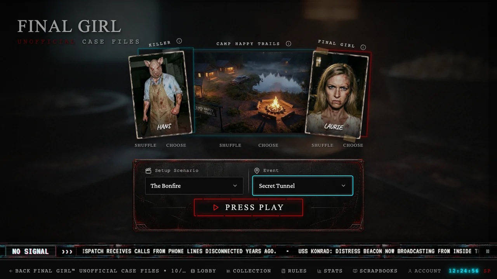
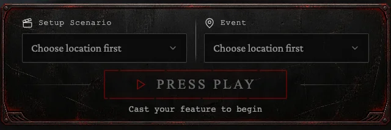
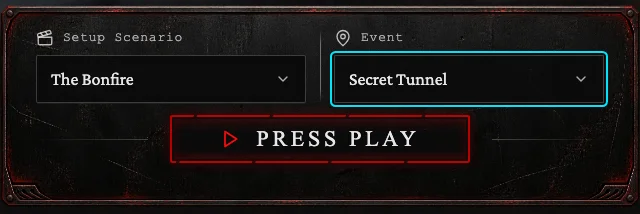
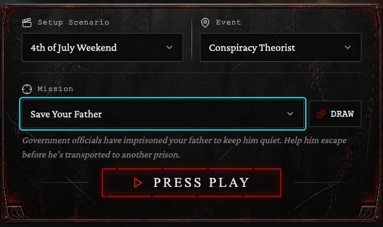
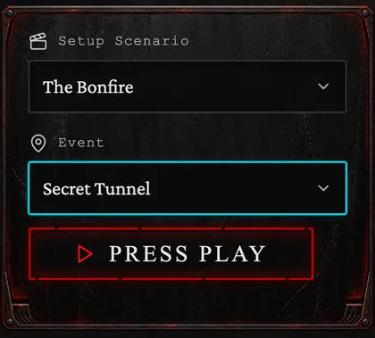

# Laptop setup console refinement

The Setup Scenario and Event controls previously shared the photo collage's shrinking width. At short laptop heights the panel could narrow to about 440px, while its content padding shrank below the decorative rim width. Large separate icon columns and uppercase values further reduced the usable text area.

The console now keeps a 640px minimum on desktop, capped at the existing 800px maximum. The photographs retain their original size formula, positions, and artwork. Small icons sit beside the labels, freeing the selector width for mixed-case values in the existing local Crimson Pro font. Selectors are 48px high. Labels, padding, and the frame thickness share a clear inner margin; menu options use the same readable text face and wrap naturally.

The controls stack when their container becomes narrow. On small phones, the Mission draw button moves alongside the label so the mission name retains the full selector width. The existing options, random draw behavior, description, state reset, and story payload are unchanged. The helper's space remains reserved so Press Play does not move when casting is completed.

Normal laptop sizes, including 1366×768, retain the single-page arrangement. A 720px-high window may scroll slightly to preserve readable controls and the unchanged photographs. Bottom padding reserves the fixed ticker as well as the footer so the entire faceplate can be scrolled clear of both.

## Scope and release

Only `ScenarioDropdowns.tsx` markup/classes and console rules in `casting.css` change in production. Existing frame artwork and local fonts are reused. No change to the main page, casting-photo layout, game behavior, backend functions, or schema. Frontend-only deployment; no migration, new runtime artwork, secret, or dependency.

## Validation

Browser checks cover empty and selected states, stable Press Play placement, keyboard selection, long options, Mission selection/draw/reset, 320px phones, laptop viewports, and 125% CSS zoom. They check text clipping, readable control dimensions, inner-rim clearance, menu bounds, ticker/footer clearance, and unchanged photograph sizing. Layout measurements are attached to the browser report.

Validation: 249 frontend tests and 59 edge checks passed. The full desktop/mobile browser run passed 223 of 224 checks, including every Setup check. The existing Lobby Escape-dismissal test intermittently sent its key before the dialog's focus scope mounted; it now waits for focus inside the dialog and passed all 20 repeated desktop/mobile checks. No Lobby production code changes. Type checking, production build and validation of 226 original artwork files passed. Lint reports zero errors and nine existing React Refresh warnings.

## Review captures

Actual browser captures from the regression suite:

| Empty | Selected |
| --- | --- |
|  |  |

