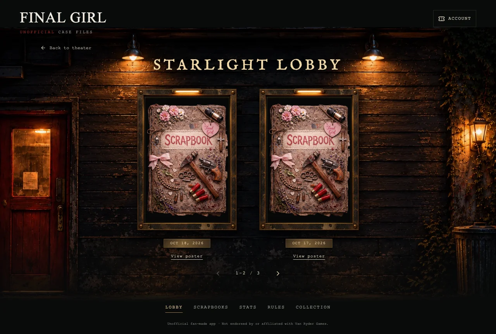
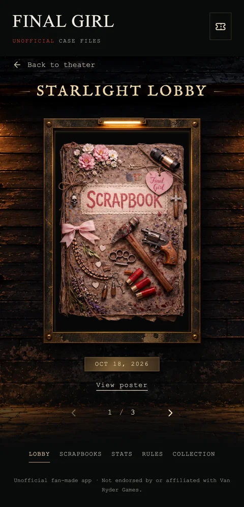

# Starlight Lobby

The Lobby is a separate page in the app's existing navigation. Open it from the theater footer or the shared footer on Collection, Rules, Stats, Scrapbooks, and Setup. It uses the same signed-in history and opens a poster's exact scrapbook entry through the existing case-file handoff. Back to theater preserves the current game.

## Presentation

The new wall and transparent cabinet frame are original generated assets. The cabinet contains the player's actual saved poster, with its proportions and full lettering preserved. Two cases appear on desktop; phones show one. Previous/next buttons, gallery arrow keys, and horizontal touch swipes browse manually. There is no automatic poster carousel.

The full-poster dialog supports Escape, backdrop dismissal, keyboard focus restoration, and Open case file. Failed downloads offer Retry poster. Empty, loading, signed-out, and archive-error states do not fabricate films or generate images. Only the visible posters are mounted. Legacy inline posters are fetched on demand for the visible cases and retained in page memory rather than copied into localStorage.

## Main-page scope

- One Lobby link added to the existing footer.
- Completed and active theater reels use opening stills only. A missing/broken still never falls back to a poster.
- Image dimensions are checked before promotion into the projection. Portrait images incorrectly saved in the scene field are rejected. Older square opening stills remain compatible.
- The existing scenery, calibrated aperture, main-page CSS, typography, program sign, controls, and layout are unchanged. The lobby has its own lazy-loaded CSS and artwork; they are not requested on the initial theater view.

## Validation and release

`npm run check`, `npm run check:assets`, production build, and the complete desktop/phone browser suite. Lobby checks cover separate navigation, no eager poster/artwork loading on the theater, correct case selection, manual paging, unavailable-image recovery, legacy reads, active-game preservation, portrait rejection, keyboard focus, swiping, and 320px dialog/page bounds. Existing theater checks cover the calibrated screen, transitions, retry, controls, and responsive geometry.

This is a frontend-only release. No SQL migration, edge-function deployment, secret, or automatic artwork-generation call is added. No production data was changed during development.

Review screenshots use existing portrait fixture artwork in place of private player posters.

Final local result: 249 frontend tests, 59 edge/handler checks, and all 220 desktop/phone browser checks passed. Production build, type checks, and 226-artwork validation passed. Lint retains the nine existing fast-refresh warnings.

| Desktop lobby | Phone lobby |
| --- | --- |
|  |  |

[Main page with footer link](images/starlight-home-lobby-link.webp) · [Phone poster viewer](images/starlight-poster-viewer.webp)
