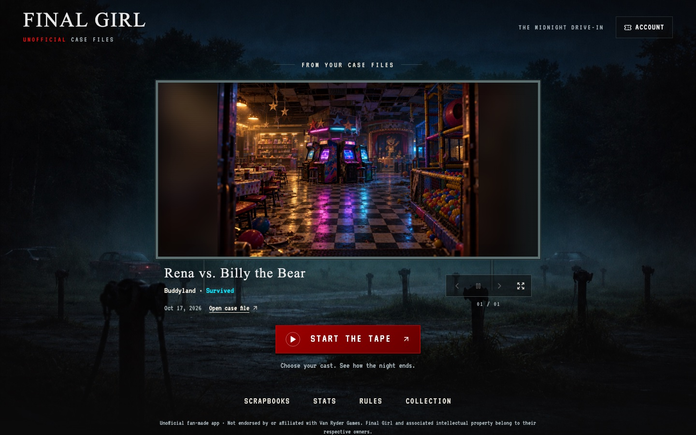
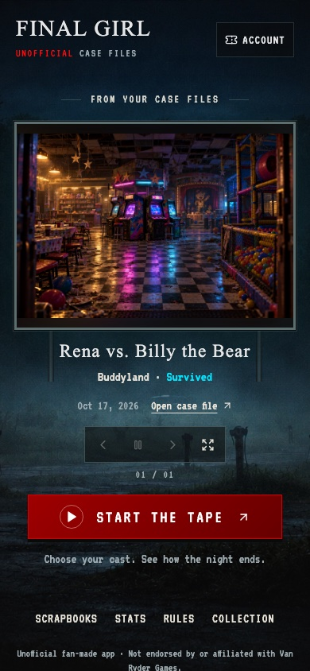

# The midnight drive-in

The homepage keeps the drive-in theater and projects the player's own saved scenes. The screen is now independent of the background crop, so the complete screen and controls fit on phones, landscape devices, and desktops. Portrait artwork uses its original proportions over a softly blurred extension.

## Review sequence

Three cumulative branches target **main**, not one another. Merge in this order using **Create a merge commit** so later diffs lose the preceding stages cleanly:

1. [PR #42](https://github.com/LeviJohnsonNC/finalgirl/pull/42), `codex/theater-1-composition` — responsive theater, original adapted backdrop, opening title card, readable navigation.
2. `codex/theater-2-screenings` — personal scene captions, exact case files, projection controls, image recovery.
3. `codex/theater-3-return` — integrated resume and recovery, accessibility, final regression coverage.

The series is frontend-only. **No SQL migrations or edge-function deployments are needed.** Publish the frontend after the final PR. Opening the theater does not call generation or narration services.

## Visual review

The backdrop is an original adaptation of the existing drive-in: the baked-in screen was removed so the app can lay out the projection independently. It is delivered as a compressed JPEG (about 434 KB). The original backdrop is retained.

These screenshots use a mocked record and the existing original Buddyland location illustration. They contain no production account data.

## Validation

Composition stage: frontend typecheck, 176 unit tests, 38 edge tests, lint (zero errors; nine pre-existing fast-refresh warnings), production build, and 116 artwork checks pass. The new theater browser scenarios pass on desktop and phone, including layout widths 320, 390, 844, and 1440 pixels. The existing Buddyland browser scenarios also pass.

Screening stage: 12 targeted unit tests cover stable selection, poster fallback, image errors/timeouts, stale responses, hidden tabs, reduced motion, and cleanup. Ten theater browser scenarios pass across desktop and phone, including full-size viewing, focus restoration, and opening the precise recorded game. The next frame is preloaded; automatic changes wait 16 seconds and crossfade for 3 seconds. Interaction pauses rotation, and manual navigation leaves the reel paused. Reduced motion disables autoplay.

The reel contains up to 24 distinct images, starting with the most recent game and varying matchups where possible. It keeps the chosen game across unrelated history refreshes. Missing scene images can fall back to that same game's poster. No story text is fetched until a case file is opened. Projection state is discarded on account changes.

Final resume acceptance results will be added with the remaining stage. Production hosting and a physical iPhone still need a smoke test after publishing.
