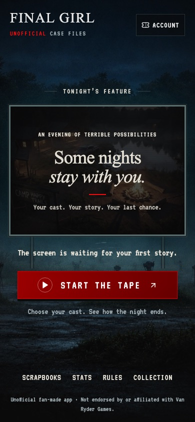
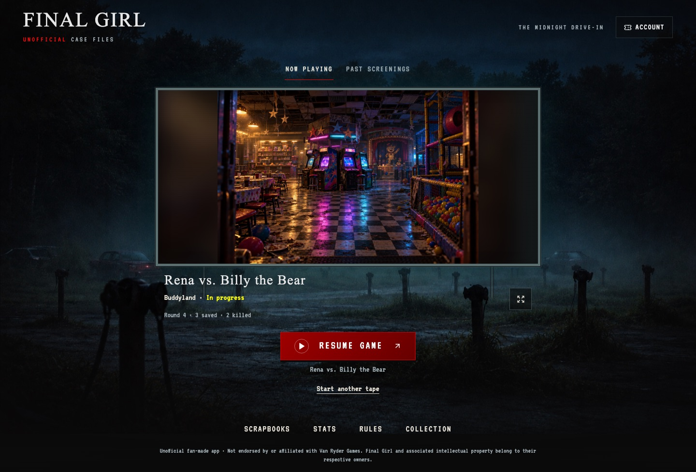
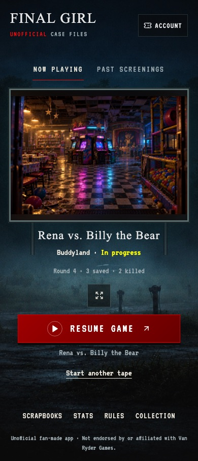

# The midnight drive-in

The homepage keeps the drive-in theater and projects the player's own saved scenes. The screen is now independent of the background crop, so the complete screen and controls fit on phones, landscape devices, and desktops. Portrait artwork uses its original proportions over a softly blurred extension.

## Review sequence

Three cumulative branches target **main**, not one another. Merge in this order using **Create a merge commit** so later diffs lose the preceding stages cleanly:

1. [PR #42](https://github.com/LeviJohnsonNC/finalgirl/pull/42), `codex/theater-1-composition` — responsive theater, original adapted backdrop, opening title card, readable navigation.
2. [PR #43](https://github.com/LeviJohnsonNC/finalgirl/pull/43), `codex/theater-2-screenings` — personal scene captions, exact case files, projection controls, image recovery.
3. `codex/theater-3-return` — integrated resume and recovery, accessibility, final regression coverage.

The series is frontend-only. **No SQL migrations or edge-function deployments are needed.** Publish the frontend after the final PR. Opening the theater does not call generation or narration services.

## Visual review

The backdrop is an original adaptation of the existing drive-in: the baked-in screen was removed so the app can lay out the projection independently. It is delivered as a compressed JPEG (about 434 KB). The original backdrop is retained. The opening title card uses a smaller JPEG derived from the existing original Camp Happy Trails illustration, avoiding the full-size PNG on first visits.

These screenshots use a mocked record and the existing original Buddyland location illustration. They contain no production account data.

## Validation

Composition stage: frontend typecheck, 176 unit tests, 38 edge tests, lint (zero errors; nine pre-existing fast-refresh warnings), production build, and 116 artwork checks pass. The new theater browser scenarios pass on desktop and phone, including layout widths 320, 390, 844, and 1440 pixels. The existing Buddyland browser scenarios also pass.

Screening stage: 12 targeted unit tests cover stable selection, poster fallback, image errors/timeouts, stale responses, hidden tabs, reduced motion, and cleanup. Ten theater browser scenarios pass across desktop and phone, including full-size viewing, focus restoration, and opening the precise recorded game. The next frame is preloaded; automatic changes wait 16 seconds and crossfade for 3 seconds. Interaction pauses rotation, and manual navigation leaves the reel paused. Reduced motion disables autoplay.

The reel contains up to 24 distinct images, starting with the most recent game and varying matchups where possible. It keeps the chosen game across unrelated history refreshes. Missing scene images can fall back to that same game's poster. No story text is fetched until a case file is opened. Projection state is discarded on account changes.

Final stage: 192 frontend unit tests and 38 edge tests pass, along with typecheck, lint (zero errors; the same nine pre-existing warnings), production build, and 117 artwork checks. All 54 browser scenarios pass across desktop and Chromium phone emulation. The theater coverage includes cloud-only resume, actual tracked progress, confirmation before closing an unfinished game, storage failure recovery, and sign-out isolation. Hook tests also verify that a previous account's cloud game is hidden on the first render and that acknowledged closed sessions leave the resume list.

## Returning to a game

An unfinished local game takes precedence over cloud games and past screenings. Its real scene or poster appears under **Now playing**, with the recorded round and victim totals when available. Unknown rounds remain unknown. **Past screenings** still opens the saved reel; the main Resume action continues the unfinished game identified below it.

Without a local draft, the most recently updated open cloud game gets **Resume cloud game**. Adopting it persists a recoverable copy before entering play. Other cloud games remain available below the screen. Closing a local unfinished game requires confirmation, and a failed durable close leaves both the game and confirmation open. Starting another tape from a cloud-only listing leaves that remote game intact.

## Publish and smoke test

1. Merge the three PRs into main in the order above, using **Create a merge commit**. Each PR targets main directly; later diffs include the earlier stages until they are merged.
2. Let Lovable sync the final main commit, then publish the frontend. No new database migration, secrets, or edge-function redeployment is required by this series.
3. On the published site, check the first visit, an account with saved artwork, and an unfinished game. Open a precise case file from its projected scene, resume tracking, and verify that sign-out clears account-specific artwork and resume details.
4. On a physical phone, check portrait/landscape scrolling, full-size artwork, and the bottom navigation. Also check reduced-motion settings and keyboard focus on desktop.

Production hosting and physical iPhone Safari are not verified by the local Chromium runs. All automated providers and account records were mocked; no production game records were changed during testing.
