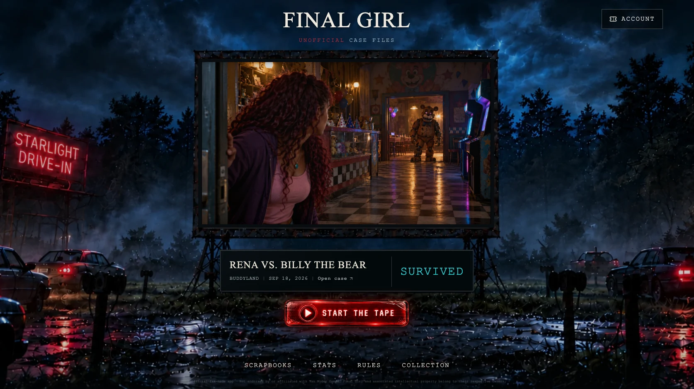
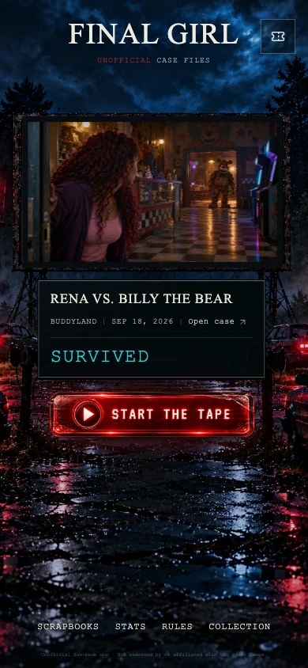

# Starlight drive-in

The scenery, steel frame, trestles, contact shadows, cars, mist, neon sign and blank marquee backplate are one photographic coordinate plane. Live artwork and the case marquee share its scale and position. Do not add independently scaled scenery or CSS support posts.

## Artwork registration

| Composition | Source size | Live 16:9 aperture (x, y, width, height) | Marquee anchor (x, y, width) |
| --- | --- | --- | --- |
| Landscape | 1915 × 821 | 690, 159, 532, 299.25 | 724, 505, 466 |
| Portrait | 910 × 1729 | 222, 477, 526, 295.875 | 244, 811, 478 |

The live aperture is exactly 16:9. A narrow dark projection gasket seals the photograph's opening. Object-fit contain preserves every saved picture; older portrait or differently shaped artwork gets quiet dark matting. There is no blurred duplicate image. A shared surface texture and restrained light modulation keep the picture on a physical screen.

The generated panorama and separately composed portrait are optimized WebP files (283 KiB / 306 KiB). Only the selected scene loads initially. An alternate composition must decode before artwork and coordinates swap together. Resize request tickets ignore stale completions; a failed alternate preserves the existing aligned scene. A portrait-download failure still leaves a usable, scaled landscape fallback below the phone header.

The photograph overscans wide displays. At narrow tablet widths its scale is capped to keep the screen inside the viewport. Phone framing prioritizes the screen and foreground; the left-hand roadside sign is outside that tighter crop. The live marquee may grow for long titles, larger text or active-game controls. A ResizeObserver reserves room for its actions and the measured footer height without feeding the measured height back into the photographic scale. Short displays scroll normally.

## Live marquee

The dark metal/glass marquee is roughly 88% of projection width. It contains the matchup, location, recorded date, exact case action, and a larger outcome label. Phone content stacks into readable rows. Active games put Now playing / Past screenings inside the marquee, with their actual round and victim summary. The larger cyan outcome occupies the space previously used by transport controls; longer outcomes wrap at a balanced size.

Outcome labels respect recorded health: a win with health above zero is Survived; a simultaneous-death win is Sacrificial victory; older wins without recorded health say Victory. Unknown dates are omitted. Case identifiers and survival are never invented.

The centered brand, compact Account control, 300px desktop / 260px phone tape action, secondary navigation and quiet single-line legal footer complete the composition. Existing start/resume and protected replacement flows are preserved.

## Projection and accessibility

The screen's black light layer varies opacity from .006 to .018 over an irregular 5.9-second sequence. It affects only projected light. The reel plays automatically without playback or scene-navigation controls. Interaction with the screen/marquee and document visibility suspend it while a case is being read. Background and tape-action interaction do not unnecessarily pause it. Reduced motion removes the animation and automatic rotation; case files remain available through the case action and Scrapbooks.

## Review

Browser captures were inspected at the 1674 × 940 reference size, 390 × 844 and 320 × 568 phones, 640 × 900 tablet and 2560 × 1080 ultrawide. Geometry checks cover additional breakpoint and landscape sizes. Rejected passes had overly wide apertures; refinement corrected tablet overflow, header spacing, phone dead space, background brightness and pointer suspension after the full-scene layout changed.

Regression coverage measures the live aperture against each photograph, exercises delayed/failed alternate downloads and rapid resize reversal, checks long titles and sacrificial victories, and retains slideshow, poster fallback, reduced-motion, case-file, start/resume, offline replacement and sign-out flows. Browser requests use fixtures; no production user data or provider calls are used. Preview images are actual browser captures with a fixture case and a local cinematic still.

