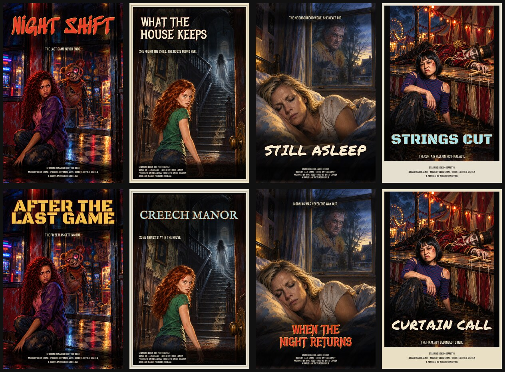

# Ending poster design review

Levi's 2026-10-28 examples establish the goal: preserve the improved painted artwork while recovering individual poster identities. The current Creech/Groves/Maple/Carnival examples repeat a red lower serif title, upper tagline and identical minimal billing. Preferred older examples include Night Shift's upper red/yellow lettering, Zero Hour's cream brush lettering, Falconwood's lower lettering and separate cream billing panel, and Falconwood Mirror's framed print.

User reference screenshots, in order: Library `libfile_5a4f248780b481919ba11a7b095733e4`, `libfile_8a8340a6659881918bcbd63b80b38ead`, `libfile_d581c04a53088191adb51ecf7ccabd31`, `libfile_4f3daa4d2c30819193251ef5ea4ac874`. The originals were opened and compared; they are not redistributed with the app.

## Finished collection



Left to right, top row: Night Shift (crown/slash/ember), What the House Keeps (inset/gothic/bone), Still Asleep (basement/brush/bone), Strings Cut (marquee/industrial/electric). Bottom row repeats the four settings with different title lengths, faces and palettes. All five title faces, four palettes and four layouts are represented. Credits use selected character names and the archive's fictional studio crew. Layouts and colors are coordinated recipes, not arbitrary model-provided coordinates or executable styles.

These are **illustrative design/compositor studies**, not the deployed app's planner or image provider. They use synthetic review stories, four images generated with the available image-generation tool, and the real `composePoster` implementation. Four additional studies reuse those paintings to compare alternative print treatments. Initial Buddyland/Creech images put faces too high; they were rejected for those upper-title layouts and recomposed. Production prompt direction was strengthened to protect every head, including distant killers/ghosts. This manual art correction does not prove that a live provider always honors safe zones; live output review remains a release check.

## Source paintings

Native 1024×1536 originals remain intact in generation history. The immutable source IDs below are also recorded in `cases.json`.

| Setting | Reviewed generated source |
| --- | --- |
| Buddyland | `exec-9a7f9906-1f69-4654-a954-6d95249af5b4.png` |
| Creech Manor | `exec-d43af60a-3a8b-46ed-b7d6-bb9265bcbf42.png` |
| Maple Lane | `exec-0f49338e-7bc9-4d5b-9689-3eeb2f870b66.png` |
| Carnival of Blood | `exec-966a31f9-ae6f-4fc3-af8e-d8ab261cc5e6.png` |

The portable cases include story, selected cast, result, copy and print design. They are QA fixtures; they are never game observations, saved player data or new canonical lore.

## Reproduce

Resolve the listed source paintings into a local directory. With Deno and cached/native dependencies available:

```sh
deno run --no-config --no-lock --allow-read --allow-write --allow-net=deno.land,cdn.jsdelivr.net scripts/poster-design-review.ts docs/reference/ending-posters/cases.json /tmp/poster-review-eight render /path/to/source-paintings
npm run build
POSTER_REVIEW_OUTPUT=/tmp/poster-review-eight npx playwright test --config docs/reference/ending-posters/playwright.config.ts
```

The opt-in capture suite serves the actual compiled app on isolated port 4174. It opens all eight complete raster posters in the ending reader, verifies native dimensions/full proportions and horizontal fit, and captures 1280×640, 1366×768, 1440×900, 390×844 and 320×568 plus the expanded phone view. Ordinary browser CI remains independent of local/generated review files. Synthetic services do not prove production deployment or live generation quality.
